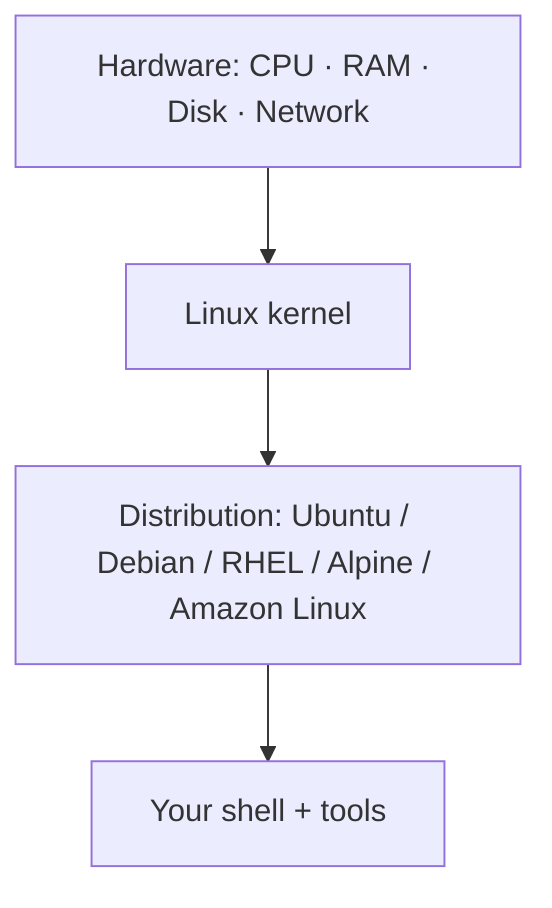
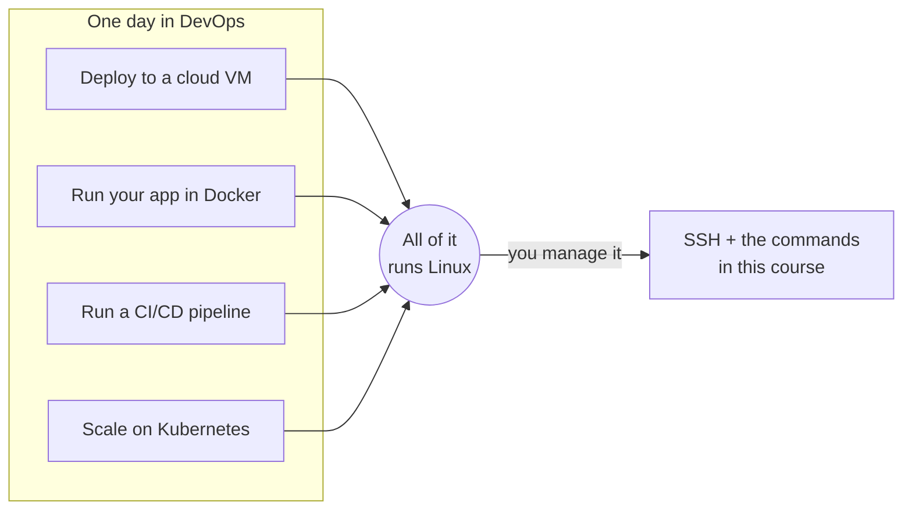

# Why Every DevOps Engineer Needs Linux

> [Linux for DevOps](../../README.md) · Module 1 — Linux Basics

> 📺 **Watch:** _video link coming soon_

## What you'll learn
- What Linux actually is (kernel vs distribution)
- The major distributions and where each is used
- Why the cloud runs on Linux
- Install Ubuntu (WSL on Windows, Multipass on macOS)
- SSH into a remote server for the first time

## Concepts

**Linux is a kernel** — the core that talks to your hardware. A **distribution** ("distro") bundles that kernel with tools, a package manager, and defaults. Same engine, different cars.



Common distros you'll meet in DevOps:

| Distro | Where you'll see it |
|---|---|
| **Ubuntu / Debian** | Default for most cloud VMs and tutorials |
| **RHEL / Rocky / Alma** | Enterprise servers |
| **Amazon Linux** | AWS EC2 |
| **Alpine** | Tiny container base images |

### Why DevOps runs on Linux

Look at one normal day in DevOps. You deploy to a **cloud VM** — it runs Linux. Your app runs in a **Docker container** — every container is a Linux process. Your pipeline runs on a **CI/CD runner** — a Linux box. Your cluster schedules pods onto **Kubernetes nodes** — Linux again. The tools keep changing; the operating system under all of them stays the same.



More than **9 out of 10 cloud servers run Linux**. Four simple reasons why it won:

| Reason | What it means for you |
|---|---|
| **Free** | No license fee per server — start 1,000 VMs, pay $0 for the OS |
| **Scriptable** | Everything is a file or a command, so everything can be automated |
| **Stable** | Servers run for years without a restart |
| **The same everywhere** | The commands you learn here work on AWS, Azure, GCP, and your laptop |

So this is the deal: every server you will ever touch is a Linux box you reach over **SSH**. Learn Linux once, and you can work on all of them.

## Commands
```bash
# Windows: ONE command installs both WSL and Ubuntu.
# Step 1 — open PowerShell as Administrator (Start → type "PowerShell" →
#          right-click → "Run as administrator"), then run:
wsl --install -d Ubuntu
# Step 2 — restart your computer when it finishes.
# Step 3 — Ubuntu opens by itself: create your Linux username + password
#          (separate from your Windows login).
# Later: open Ubuntu from the Start menu, or just type `wsl` in any terminal.
# If Windows says "wsl is not recognized": install Windows updates, try again.

# macOS: the Mac Terminal is NOT Linux (no apt, no systemd).
# Get a real Ubuntu VM with Multipass:
brew install --cask multipass
multipass launch --name devops         # create the Ubuntu VM
multipass shell devops                 # enter it — you are now on Linux

# Confirm you're on Linux
uname -a                       # kernel + arch
cat /etc/os-release            # which distro/version
whoami                         # current user

# SSH into a remote server — optional for now, you will do it a lot later
ssh ubuntu@<server-ip>
# ...you're now on the server:
uname -a
exit                           # back to your machine
```

## In production
Launch a cloud VM (AWS EC2, DigitalOcean, etc.), then connect with `ssh user@ip`. From that moment, everything you do — installing software, deploying apps, reading logs — happens over this connection. Getting comfortable here is step zero of DevOps.

## Practice
- Install Ubuntu (WSL on Windows, Multipass on macOS) and run `uname -a`, `whoami`, and `cat /etc/os-release`.
- Run [`scripts/server-info.sh`](scripts/server-info.sh) inside your Ubuntu and read the output.
- Optional (needs a cloud account): create a free-tier cloud VM and SSH into it.

## Cheat sheet
| Command | What it does |
|---|---|
| `uname -a` | Kernel + system info |
| `cat /etc/os-release` | Which distro / version |
| `whoami` | Current user |
| `ssh user@host` | Connect to a remote server |
| `wsl --install -d Ubuntu` | Install WSL + Ubuntu (admin PowerShell, then restart) |
| `wsl` | Re-enter Ubuntu from any Windows terminal |
| `multipass launch --name devops` | Create an Ubuntu VM on macOS |
| `multipass shell devops` | Enter that Ubuntu VM |

## Scripts
- [`scripts/server-info.sh`](scripts/server-info.sh) — one-glance snapshot of any Linux box (host, kernel, distro, user, uptime).

---
← [Course home](../../README.md) · **Next:** [Linux File System & Navigation](../02-file-system-and-navigation/README.md)
