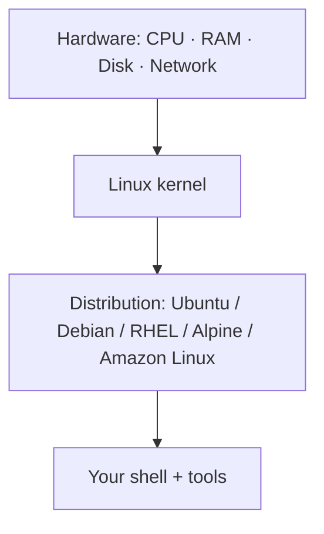

# Why Every DevOps Engineer Needs Linux

> [Linux for DevOps](../../README.md) · Module 1 — Linux Basics

> 📺 **Watch:** _video link coming soon_

## What you'll learn
- What Linux actually is (kernel vs distribution)
- The major distributions and where each is used
- Why the cloud runs on Linux
- Install Ubuntu (or WSL on Windows)
- SSH into a remote server for the first time

## Concepts

**Linux is a kernel** — the core that talks to your hardware. A **distribution** ("distro") bundles that kernel with tools, a package manager, and defaults. Same engine, different cars.



Common distros you'll meet in DevOps:

| Distro | Where you'll see it |
|---|---|
| **Ubuntu / Debian** | Default for most cloud VMs and tutorials |
| **RHEL / Rocky / Alma** | Enterprise servers |
| **Amazon Linux** | AWS EC2 |
| **Alpine** | Tiny container base images |

**Why the cloud runs on Linux:** it's free, scriptable, and lightweight — so it's cheaper to run at scale and easy to automate. Every container, CI runner, and cloud VM you'll touch is a Linux box you reach over **SSH**.

## Commands
```bash
# Windows only: install Linux via WSL
wsl --install -d Ubuntu

# Confirm you're on Linux
uname -a                       # kernel + arch
cat /etc/os-release            # which distro/version
whoami                         # current user

# SSH into a remote server (e.g. a cheap cloud VM)
ssh ubuntu@<server-ip>
# ...you're now on the server:
uname -a
exit                           # back to your machine
```

## In production
Launch a cloud VM (AWS EC2, DigitalOcean, etc.), then connect with `ssh user@ip`. From that moment, everything you do — installing software, deploying apps, reading logs — happens over this connection. Getting comfortable here is step zero of DevOps.

## Practice
- Install Ubuntu/WSL and run `uname -a`, `whoami`, and `cat /etc/os-release`.
- Spin up a free-tier cloud VM and SSH into it.
- Run [`scripts/server-info.sh`](scripts/server-info.sh) on the server and read the output.

## Cheat sheet
| Command | What it does |
|---|---|
| `uname -a` | Kernel + system info |
| `cat /etc/os-release` | Which distro / version |
| `whoami` | Current user |
| `ssh user@host` | Connect to a remote server |
| `wsl --install -d Ubuntu` | Install Linux on Windows |

## Scripts
- [`scripts/server-info.sh`](scripts/server-info.sh) — one-glance snapshot of any Linux box (host, kernel, distro, user, uptime).

---
← [Course home](../../README.md) · **Next:** [Linux File System & Navigation](../02-file-system-and-navigation/README.md)
