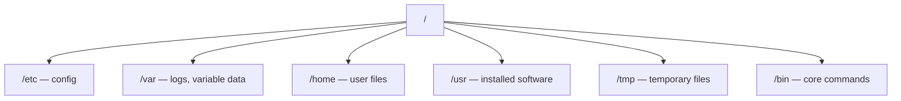

# Linux File System & Navigation

> [Linux for DevOps](../../README.md) · Module 1 — Linux Basics

> 📺 **Watch:** _video link coming soon_

## What you'll learn
- The Linux directory structure
- Where you are and how to move: `pwd`, `ls`, `cd`
- Create things: `mkdir`, `touch`
- Copy, move, remove: `cp`, `mv`, `rm`
- Find anything: `find`

## Concepts

In Linux **everything hangs off a single root, `/`** — there are no drive letters. Learn this tree once and you'll never feel lost on a server.



**Paths** are either **absolute** (start at `/`, e.g. `/var/log/nginx`) or **relative** (from where you are). Handy shortcuts: `.` = here, `..` = up one, `~` = your home.

## Commands
```bash
pwd                      # where am I
ls -lah                  # list: long + hidden + human sizes
cd /var/log && ls
cd ~                     # home
cd -                     # jump back to previous dir

mkdir -p projects/app/logs
touch projects/app/README.md
cp projects/app/README.md /tmp/
mv /tmp/README.md /tmp/notes.md
rm /tmp/notes.md

find / -name "*.log" -type f 2>/dev/null | head
find . -type d                    # only directories
find . -mtime -1                  # changed in the last day
```

## In production
Debugging a service is mostly navigation: `cd /etc/nginx` to read the config, `cd /var/log/nginx` to read the logs. Knowing **where things live** is half the job.

## Practice
- Recreate a small project tree with `mkdir -p`.
- Use `find` to list only the directories, then only files modified today.

## Cheat sheet
| Command | What it does |
|---|---|
| `pwd` | Where am I |
| `ls -lah` | List long + hidden + sizes |
| `cd -` | Back to previous dir |
| `mkdir -p a/b/c` | Create nested dirs |
| `find . -name "*.log"` | Find files by name |

---
← [Course home](../../README.md) · **Next:** [Working with Files](../03-working-with-files/README.md)
