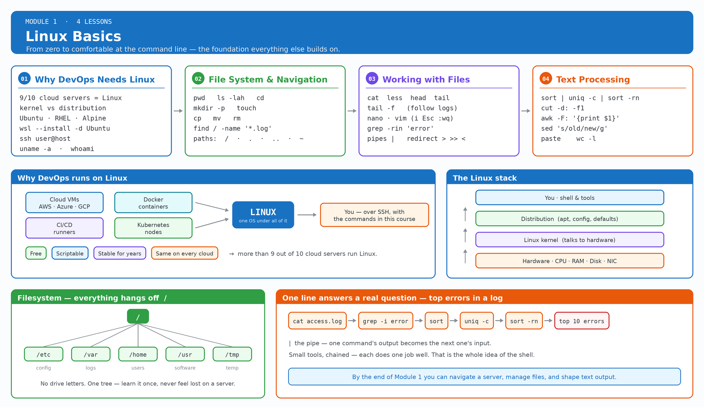

# Module 1 — Linux Basics (4 lessons)

**Goal:** get a total beginner comfortable at the Linux command line — install it, move around, read and edit files, and process text. This is the foundation every later module builds on.

_Module map — [open the editable Excalidraw version](../diagrams/module-1-linux-basics.excalidraw)._

| # | Lesson | Covers |
|---|---|---|
| 01 | [Why Every DevOps Engineer Needs Linux](01-why-devops-needs-linux/README.md) | What Linux is, distributions, why the cloud runs on Linux, install Ubuntu/WSL, SSH into a server |
| 02 | [Linux File System & Navigation](02-file-system-and-navigation/README.md) | Directory structure, `pwd` `ls` `cd`, `mkdir` `touch`, `cp` `mv` `rm`, `find` |
| 03 | [Working with Files](03-working-with-files/README.md) | `cat` `less` `head` `tail`, `nano` `vim`, `grep`, pipes, redirection |
| 04 | [Text Processing](04-text-processing/README.md) | `sort` `uniq` `cut` `paste` `wc`, `awk`, `sed` |

**Module outcome:** the viewer can navigate a server, manage files, and manipulate text output — the everyday work of ops.
