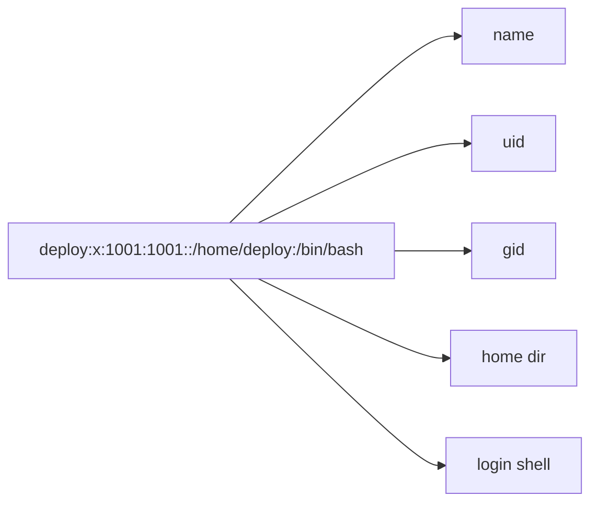

# Users & Groups

> [Linux for DevOps](../../README.md) · Module 2 — Linux Administration

> 📺 **Watch:** _video link coming soon_

## What you'll learn
- The root user and `sudo` (why you almost never log in as root)
- Create and manage users: `useradd`, `passwd`
- Groups and identity: `groups`, `id`
- Where users and groups actually live (`/etc/passwd`, `/etc/group`, `/etc/sudoers`)

## Concepts

Every Linux system has a **root** superuser that can do anything, plus regular users who each have a numeric **uid**. Users belong to **groups** (each with a **gid**), which is how Linux grants shared access without handing out root.

The golden rule is **least privilege**: you log in as a normal user and borrow root powers only for the one command that needs them, using `sudo`. That's far safer than logging in as root, where a single typo can wipe the system.

Users are just lines in a plain text file. Each line in `/etc/passwd` describes one user:



Groups live in `/etc/group`, and who is allowed to run `sudo` is defined in `/etc/sudoers`.

## Commands
```bash
id
whoami
groups

# create a user + set password
sudo useradd -m -s /bin/bash deploy
sudo passwd deploy

# grant sudo (Debian/Ubuntu)
sudo usermod -aG sudo deploy

# inspect
id deploy
grep deploy /etc/passwd
getent group sudo

# run one command as another user
sudo -u deploy whoami
```

## In production
Standard server hardening creates a non-root `deploy` user, gives it sudo, and disables direct root SSH login. Apps and CI pipelines connect as `deploy`, never as root — so no single compromised login owns the whole box.

## Practice
- Create a user `appuser`, add it to a new `webadmins` group, confirm the membership with `id`, and run a command as that user with `sudo -u`.

## Cheat sheet
| Command | What it does |
|---|---|
| `id` / `whoami` | Your uid/gid / username |
| `useradd -m -s /bin/bash u` | Create user with home + shell |
| `usermod -aG group u` | Add user to a group |
| `passwd u` | Set a user's password |
| `sudo -u u cmd` | Run a command as user `u` |

---
← [Course home](../../README.md) · **Next:** [Linux Permissions](../06-linux-permissions/README.md)
