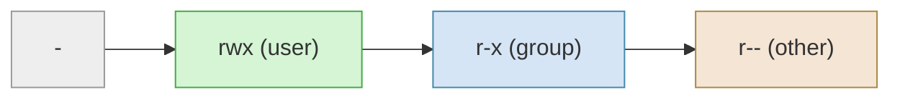

# Linux Permissions

> [Linux for DevOps](../../README.md) · Module 2 — Linux Administration

> 📺 **Watch:** _video link coming soon_

## What you'll learn
- Read a permission string (`-rwxr-xr--`) and the owner/group/other model
- Change permissions: `chmod` (symbolic + numeric)
- Change ownership: `chown`, `chgrp`
- Special bits: SUID, SGID, sticky bit

## Concepts

Every file shows its permissions as a 10-character string. The first character is the **type** (`-` file, `d` directory); the remaining nine are three sets of `rwx` — one for the **user** (owner), one for the **group**, and one for **other** (everyone else):



Those same permissions have a **numeric** shorthand: read = 4, write = 2, execute = 1, added up per group. So `rwx` = 7, `r-x` = 5, `r--` = 4 — which makes `755`, and a locked-down `rw-------` becomes `600`.

Three **special bits** sit on top: **SUID** lets a program run as its owner (that's why `passwd` works), **SGID** makes new files in a directory inherit its group, and the **sticky bit** stops users from deleting each other's files — which is why `/tmp` is `1777`.

## Commands
```bash
ls -l script.sh                  # see the permission string
chmod +x script.sh               # chmod = "change mode" — make it executable
chmod 644 config.yaml            # 644 = rw- r-- r-- → I write, everyone else reads
chmod 600 ~/.ssh/id_rsa          # 600 = rw- --- --- → only me: for keys + secrets
chmod -R 755 /var/www/html       # 755 = rwx r-x r-x → -R = also everything inside

sudo chown deploy:deploy app.log # chown = "change owner": app.log now belongs to user deploy, group deploy
sudo chgrp webadmins /var/www    # chgrp = "change group": /var/www now belongs to the webadmins group

# special bits
ls -l /usr/bin/passwd            # the 's' = SUID ("Set User ID"): always runs as its owner (root)
chmod g+s shared/                # SGID ("Set Group ID"): new files in shared/ inherit its group
ls -ld /tmp                      # the 't' = sticky bit: all can add files, only owners delete their own
```

## What the names mean

| Command | Stands for |
|---|---|
| `chmod` | **ch**ange **mod**e — "mode" is the permission set |
| `chown` | **ch**ange **own**er |
| `chgrp` | **ch**ange **gr**ou**p** |
| `rwx` | **r**ead · **w**rite · e**x**ecute |
| SUID / SGID | **S**et **U**ser **ID** / **S**et **G**roup **ID** |

## In production
Permissions explain the everyday puzzles: an app can't read its config because the owner is wrong, an SSH key is rejected until you `chmod 600` it, and a shared team directory uses SGID so every teammate can collaborate on the files without fighting over ownership.

## Practice
- Make a script executable, lock a "secret" file down to `600`, and set up a shared SGID directory where new files automatically inherit the group.

## Cheat sheet
| Command | What it does |
|---|---|
| `chmod +x f` | Make executable |
| `chmod 644 f` | rw-r--r-- |
| `chmod 600 f` | Owner-only (keys, secrets) |
| `chown u:g f` | Change owner + group |
| `chmod g+s dir` | SGID: inherit group |

---
← [Course home](../../README.md) · **Next:** [Process Management](../07-process-management/README.md)
