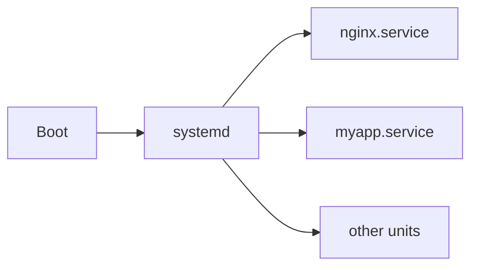

# Services & Logs

> [Linux for DevOps](../../README.md) · Module 2 — Linux Administration

> 📺 **Watch:** _video link coming soon_

## What you'll learn
- What systemd is and what a service (unit) is
- Manage services: `systemctl` (start/stop/restart/enable/status)
- Read logs the modern way: `journalctl`
- Legacy `service` command and traditional log files in `/var/log`

## Concepts

When a Linux box boots, one process starts everything else. On modern systems that's **systemd**. The things it manages are **units** — and a long-running program like a web server is a **service** unit.

A service is described by a **unit file** with three sections: `[Unit]` (metadata and dependencies), `[Service]` (what to run and how to restart it), and `[Install]` (when it should start on boot).

The distinction beginners miss: **`start` runs a service right now**, while **`enable` makes it start automatically on every boot** — two separate actions.



For logs, systemd records everything in a central journal you read with `journalctl`. Older services still write plain text files under `/var/log`, and you can watch those with `tail -f`.

## What the names mean

| Command | Stands for |
|---|---|
| `systemd` | **system** **d**aemon — a *daemon* is a program that runs in the background |
| `systemctl` | **system** **c**on**t**ro**l** |
| `journalctl` | **journal** **c**on**t**ro**l** — the journal is systemd's log book |

## Commands
```bash
systemctl status nginx             # systemctl = "system control" — running? + last logs
sudo systemctl start nginx         # start it right now
sudo systemctl enable nginx        # start on every boot
sudo systemctl restart nginx       # stop + start (after a deploy)
systemctl is-active nginx          # prints just: active / inactive
systemctl list-units --type=service   # every service on this machine

# logs   (journalctl = "journal control" — read systemd's log book)
journalctl -u nginx --no-pager | tail   # -u = only this unit's logs
journalctl -u nginx -f             # -f = follow live
journalctl --since "10 min ago"    # logs by time window
tail -f /var/log/nginx/error.log   # classic plain log file, followed live

# write a tiny custom service
sudo nano /etc/systemd/system/hello.service   # write the unit file
sudo systemctl daemon-reload                  # tell systemd to re-read unit files
sudo systemctl enable --now hello.service     # start now + on every boot
```

## In production
You run a Python or Node app as a managed service so it survives crashes and reboots, then tail its logs live with `journalctl -u myapp -f` while a deploy goes out — watching for errors as the new version comes up.

## Practice
- Write a minimal `hello.service` that runs a script, enable it, confirm it starts on boot, and read its output with `journalctl -u hello`.

## Cheat sheet
| Command | What it does |
|---|---|
| `systemctl status svc` | Is it running + recent logs |
| `systemctl enable --now svc` | Start now + on boot |
| `systemctl restart svc` | Restart |
| `journalctl -u svc -f` | Follow a service's logs |
| `journalctl --since "1h ago"` | Time-filtered logs |

---
← [Course home](../../README.md) · **Next:** [Package Management](../09-package-management/README.md)
