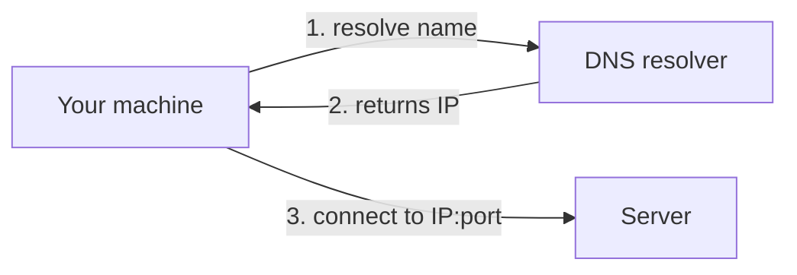

# Linux Networking

> [Linux for DevOps](../../README.md) · Module 3 — Networking

> 📺 **Watch:** _video link coming soon_

## What you'll learn
- IP addresses, ports, and interfaces
- DNS: how a name becomes an IP
- Test connectivity: `ping`, `curl`, `wget`
- Identity + interfaces: `hostname`, `ip addr`

## Concepts
An **IP address** identifies a machine on a network, and a **port** identifies a service on that machine. Together they form a **socket** — the exact endpoint traffic connects to. IPs come in two kinds: **private** (reachable only inside your network) and **public** (reachable from the internet).

You rarely type IPs directly — you type names. **DNS** is what turns a name like `google.com` into an IP. Your machine asks a **resolver**, the resolver looks up the name, and hands back the address so the connection can be made.

Put it together and every request follows the same path: your box asks DNS for the address, then connects to that server on a specific port.



## Commands
```bash
hostname
hostname -I

ip addr            # interfaces + IPs (modern)
ip route           # default gateway

# DNS + reachability
ping -c 4 google.com
curl -I https://example.com          # headers only
curl https://api.github.com/zen
wget https://example.com/file.txt

cat /etc/hosts
cat /etc/resolv.conf                 # which DNS servers
```

## In production
You health-check an API straight from the server: `curl -I` to confirm it's up and returning 200, `ping` to confirm the host is reachable, and `ip addr` to confirm the box's own address.

## Practice
- Find your server's private and public IP.
- `curl -I` a website and read the status code it returns.
- Add a custom entry to `/etc/hosts`.

## Cheat sheet
| Command | What it does |
|---|---|
| `ip addr` | Interfaces + IPs |
| `ping host` | Reachability test |
| `curl -I url` | HTTP headers / status |
| `hostname -I` | This box's IP(s) |
| `cat /etc/resolv.conf` | Configured DNS servers |

---
← [Course home](../../README.md) · **Next:** [Network Troubleshooting](../11-network-troubleshooting/README.md)
