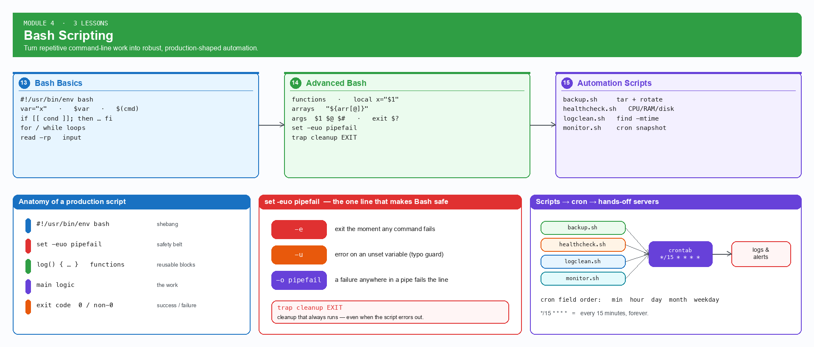

# Module 4 — Bash Scripting (3 lessons)

**Goal:** turn manual command-line work into automation. From variables and loops to real, production-shaped scripts an engineer would actually keep.

_Module map — [open the editable Excalidraw version](../diagrams/module-4-bash-scripting.excalidraw)._

| # | Lesson | Covers |
|---|---|---|
| 13 | [Bash Basics](13-bash-basics/README.md) | Variables, input, output, conditions, loops |
| 14 | [Advanced Bash](14-advanced-bash/README.md) | Functions, arrays, arguments, exit codes, error handling |
| 15 | [Automation Scripts](15-automation-scripts/README.md) | Backup script, health check, log cleanup, server monitoring |

**Module outcome:** the viewer can write robust Bash scripts with proper error handling and automate repetitive ops tasks.

Reusable scripts built in this module live in each lesson's `scripts/` folder.
