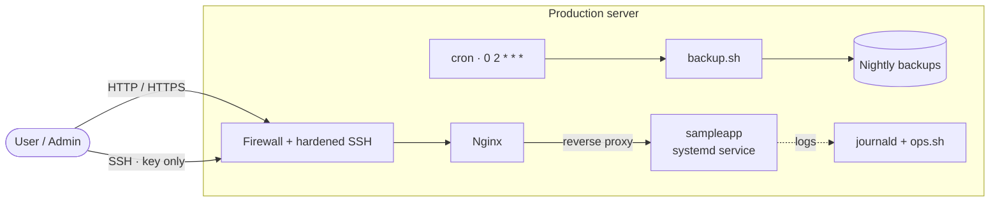

# Capstone: Deploy a Production Linux Server

> [Linux for DevOps](../../README.md) · Module 5 — Linux for DevOps

> 📺 **Watch:** _video link coming soon_

This is the capstone. You take a bare Ubuntu server from zero to production-shaped, using every skill in the course. At the end you have a secured, monitored, application-serving Linux server you built end to end — a real project you can put on a resume.

## The project
Six goals, each pulling on a skill from earlier modules:

1. **Create users** — a non-root `deploy` user with sudo. _(Module 2)_
2. **Secure SSH** — key-only login; disable root and password auth. _(Module 3)_
3. **Configure Nginx** — install, serve a site, and reverse-proxy the app. _(Modules 2 + 3)_
4. **Deploy a sample application** — run it as a systemd service so it survives reboots and crashes. _(Module 2)_
5. **Schedule backups** — the backup script on a cron timer. _(Modules 4 + 5)_
6. **Monitor logs** — journald plus the ops toolkit health checks. _(Modules 2 + 5)_

## Architecture
The end state: users reach the box only through a firewall and hardened SSH; Nginx fronts the app; cron backs it up nightly; journald and the ops toolkit keep watch.



## Build it
Work through the six steps on a fresh cloud VM. The full script is in [`scripts/setup-server.sh`](scripts/setup-server.sh).

```bash
# 1. create a non-root deploy user with sudo
sudo useradd -m -s /bin/bash deploy && sudo usermod -aG sudo deploy

# 2. harden SSH: install your key, then disable password + root login
ssh-copy-id deploy@<ip>
sudo sed -i 's/^#\?PasswordAuthentication.*/PasswordAuthentication no/' /etc/ssh/sshd_config
sudo sed -i 's/^#\?PermitRootLogin.*/PermitRootLogin no/' /etc/ssh/sshd_config
sudo systemctl restart ssh

# 3. install and enable Nginx
sudo apt update && sudo apt install -y nginx
sudo systemctl enable --now nginx

# 4. run the app as a systemd service (see scripts/sampleapp.service)
sudo tee /etc/systemd/system/sampleapp.service >/dev/null <<'EOF'
[Unit]
Description=Sample App
After=network.target
[Service]
User=deploy
ExecStart=/usr/bin/python3 /home/deploy/app/main.py
Restart=always
[Install]
WantedBy=multi-user.target
EOF
sudo systemctl daemon-reload && sudo systemctl enable --now sampleapp

# 5. schedule nightly backups via cron
( crontab -l 2>/dev/null; echo "0 2 * * * /home/deploy/backup.sh" ) | crontab -

# 6. monitor
journalctl -u sampleapp -f
./ops.sh disk && ./ops.sh ports
```

## Prove it
Confirm the server actually behaves like a production box:

- **Serve traffic.** Open `http://<ip>` in a browser and see the app respond through Nginx.
- **Self-heal.** Kill the app — `sudo systemctl kill sampleapp` — then run `systemctl status sampleapp` and watch systemd restart it automatically (that's `Restart=always` earning its keep).
- **Back up on demand.** Run `/home/deploy/backup.sh` by hand and confirm a fresh archive lands where you expect, then check the cron entry with `crontab -l`.
- **Health check.** Run `./ops.sh disk` and `./ops.sh ports`, and tail the app's logs with `journalctl -u sampleapp -f`.

Everything on the checklist should now be true: user ✅ · SSH hardened ✅ · Nginx ✅ · app as a service ✅ · backups scheduled ✅ · monitoring ✅.

## Final challenge
- Reproduce the whole deploy on a fresh VM from scratch.
- Intentionally break the app service and confirm it self-heals.
- Confirm SSH now refuses password login (try `ssh -o PubkeyAuthentication=no deploy@<ip>` — it should be rejected).

## Scripts
- [`scripts/setup-server.sh`](scripts/setup-server.sh) — best-effort script that runs the six build steps end to end.
- [`scripts/sampleapp.service`](scripts/sampleapp.service) — the systemd unit that runs the sample app and restarts it on failure.

---
← [Course home](../../README.md) · 🎉 **You finished the course!** Next up on the channel: **Git & GitHub**.
