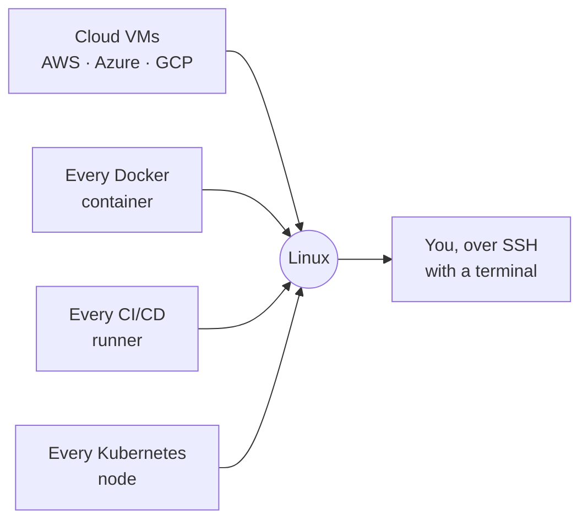

<div align="center">

# 🐧 Linux for DevOps

**The hands-on course that takes you from `whoami` to deploying a production server.**

The companion repository for the **Linux for DevOps** course on YouTube by [@devopsbymuh](https://youtube.com/@codewithmuh).

[](https://youtube.com/@codewithmuh)
[](https://www.gnu.org/software/bash/)
[](https://kernel.org)


[](LICENSE)

</div>

---

Watch the videos to **learn**, then use this repo as your **reference**: concept notes, command tables, diagrams, cheat sheets, and copy-paste-ready scripts for every lesson.

> 📺 **Full playlist:** _link coming soon_

## 📚 Table of contents

- [Who this is for](#-who-this-is-for)
- [Why Linux?](#-why-linux)
- [What you'll learn](#-what-youll-learn)
- [Course content](#-course-content)
- [Module maps](#-module-maps)
- [Getting started](#-getting-started)
- [How to use this repo](#-how-to-use-this-repo)
- [Prerequisites](#-prerequisites)
- [Roadmap](#-roadmap)
- [Contributing](#-contributing)

## 🎯 Who this is for

- **Developers** whose code works on their laptop but breaks the moment it lands on a server.
- **Aspiring DevOps / SRE / Cloud engineers** who need Linux as a foundation.
- **Anyone** who wants to truly understand the server they are working on.

No prior Linux experience required — we start from the very first `ssh` and build up.

## 🐧 Why Linux?

Because in DevOps, **everything you touch is a Linux box**:



More than **9 out of 10 cloud servers run Linux**. It won because it is **free** (no license fee per server), **scriptable** (everything can be automated from the command line), **stable** (servers run for years without a restart), and **the same everywhere** (the commands you learn here work on any cloud).

Docker, Kubernetes, CI/CD, AWS — all of them assume you can already drive Linux. That is why this course comes first. Full story in [Lesson 01](01-linux-basics/01-why-devops-needs-linux).

## ✨ What you'll learn

- Navigate and manage a Linux system from the command line with confidence
- Handle users, groups, permissions, processes, services, and logs
- Configure networking and troubleshoot connectivity like a sysadmin
- Write real Bash scripts to automate the boring, repetitive work
- Deploy, secure, and monitor a production Linux server end-to-end

## 🗺️ Course content

**5 modules · 18 lessons**, beginner → production-ready. Each lesson has its own folder with a `README.md` (concepts + commands + cheat sheet) and, where useful, runnable `scripts/`.

### 1 · Linux Basics · [`01-linux-basics`](01-linux-basics)
| # | Lesson | |
|---|---|---|
| 01 | Why Every DevOps Engineer Needs Linux | [→](01-linux-basics/01-why-devops-needs-linux) |
| 02 | Linux File System & Navigation | [→](01-linux-basics/02-file-system-and-navigation) |
| 03 | Working with Files | [→](01-linux-basics/03-working-with-files) |
| 04 | Text Processing | [→](01-linux-basics/04-text-processing) |

### 2 · Linux Administration · [`02-linux-administration`](02-linux-administration)
| # | Lesson | |
|---|---|---|
| 05 | Users & Groups | [→](02-linux-administration/05-users-and-groups) |
| 06 | Linux Permissions | [→](02-linux-administration/06-linux-permissions) |
| 07 | Process Management | [→](02-linux-administration/07-process-management) |
| 08 | Services & Logs | [→](02-linux-administration/08-services-and-logs) |
| 09 | Package Management | [→](02-linux-administration/09-package-management) |

### 3 · Networking · [`03-networking`](03-networking)
| # | Lesson | |
|---|---|---|
| 10 | Linux Networking | [→](03-networking/10-linux-networking) |
| 11 | Network Troubleshooting | [→](03-networking/11-network-troubleshooting) |
| 12 | SSH & Remote Servers | [→](03-networking/12-ssh-and-remote-servers) |

### 4 · Bash Scripting · [`04-bash-scripting`](04-bash-scripting)
| # | Lesson | |
|---|---|---|
| 13 | Bash Basics | [→](04-bash-scripting/13-bash-basics) |
| 14 | Advanced Bash | [→](04-bash-scripting/14-advanced-bash) |
| 15 | Automation Scripts | [→](04-bash-scripting/15-automation-scripts) |

### 5 · Linux for DevOps · [`05-linux-for-devops`](05-linux-for-devops)
| # | Lesson | |
|---|---|---|
| 16 | Linux in Real DevOps | [→](05-linux-for-devops/16-linux-in-real-devops) |
| 17 | Production Linux Tasks | [→](05-linux-for-devops/17-production-linux-tasks) |
| 18 | 🏁 **Capstone:** Deploy a Production Linux Server | [→](05-linux-for-devops/18-linux-project-deploy-server) |

> The final lesson is a **capstone**: deploy a secured, monitored, application-serving Linux server from scratch.

## 🗺️ Module maps

Each module comes with a one-page visual — lesson cards plus the key concepts drawn out. Browse them all in [`diagrams/`](diagrams/), or preview Module 1 below:


> Maps are editable [Excalidraw](https://excalidraw.com) files — open any `.excalidraw` in the browser or the VS Code Excalidraw extension to remix or export your own.

## 🚀 Getting started

```bash
# 1. Clone the repo
git clone https://github.com/codewithmuh/linux-course.git
cd linux-course

# 2. Open the lesson for the video you're watching
cd 01-linux-basics/01-why-devops-needs-linux

# 3. Read the lesson and run the scripts
cat README.md
bash scripts/server-info.sh
```

No Linux machine yet? Any of these works:

- **Windows** → `wsl --install -d Ubuntu`
- **macOS / Linux** → nothing to install, open your terminal
- **Cloud** → create a free-tier VM (AWS EC2, DigitalOcean, etc.) and `ssh` in

## 📖 How to use this repo

1. Open the **module → lesson** folder for the video you're watching.
2. Follow along with the commands in the lesson `README.md`.
3. Grab the **cheat sheet** and any `scripts/` you want to keep.
4. Try the **practice challenge** at the end of each lesson.

## ✅ Prerequisites

- Any computer with a terminal
- A Linux environment (WSL, a VM, or a cloud server — see [Getting started](#-getting-started))
- No prior Linux, sysadmin, or DevOps experience needed

## 🧭 Roadmap

Linux is the first tool in a larger DevOps journey. Coming next on the channel:

**Git & GitHub → Docker → Docker Compose → GitHub Actions → AWS → Kubernetes** and beyond.

## 🤝 Contributing

Spotted a typo or a better example? Issues and PRs are welcome. 🙌

If this course helped you, consider **starring ⭐ the repo** and **subscribing on [YouTube](https://youtube.com/@codewithmuh)** — it genuinely helps.

---

<div align="center">

Built with 🐧 by [@codewithmuh](https://youtube.com/@codewithmuh)

</div>
