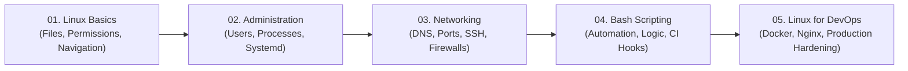
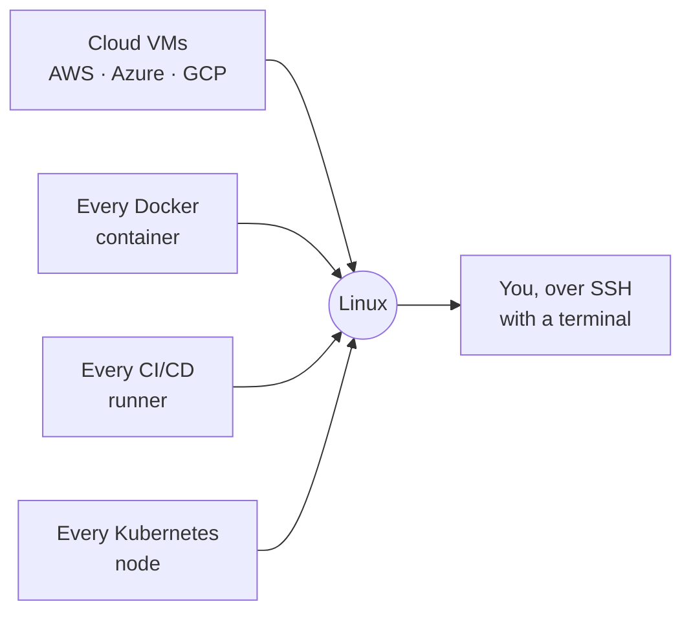

<div align="center">

# 🐧 Linux for DevOps

**The hands-on course that takes you from `whoami` to deploying a production server.**

The companion repository for the **Linux for DevOps** course on YouTube by [@devopsbymuh](https://www.youtube.com/@devopsbymuh).

<p align="center">
  <a href="https://github.com/codewithmuh/linux-course/releases"></a>
  <a href="https://github.com/codewithmuh/linux-course/stargazers"></a>
  <a href="https://github.com/codewithmuh/linux-course/network/members"></a>
  <a href="LICENSE"></a>
  <a href="https://www.youtube.com/@devopsbymuh"></a>
  <br>
  
  
   Production">
  
</p>

</div>



---

Watch the videos to **learn**, then use this repo as your **reference**: concept notes, command tables, diagrams, cheat sheets, and copy-paste-ready scripts for every lesson.

> 📺 **Full playlist:** _link coming soon_

## 📚 Table of contents

- [Who this is for](#-who-this-is-for)
- [Why Linux?](#-why-linux)
- [What you'll learn](#-what-youll-learn)
- [Course content](#-course-content)
- [Module maps](#-module-maps)
- [What every command name means](#-what-every-command-name-means)
- [Getting started](#-getting-started)
- [Practice online — no install](#-practice-online--no-install)
- [How to use this repo](#-how-to-use-this-repo)
- [Prerequisites](#-prerequisites)
- [Roadmap](#-roadmap)
- [Contributing](#-contributing)

## 🎯 Who this is for

- **Developers** whose code works on their laptop but breaks the moment it lands on a server.
- **Aspiring DevOps / SRE / Cloud engineers** who need Linux as a foundation.
- **Anyone** who wants to truly understand the server they are working on.

No prior Linux experience required — we start from the very first `ssh` and build up.

## 🐧 Why Linux?

Because in DevOps, **everything you touch is a Linux box**:



More than **9 out of 10 cloud servers run Linux**. It won because it is **free** (no license fee per server), **scriptable** (everything can be automated from the command line), **stable** (servers run for years without a restart), and **the same everywhere** (the commands you learn here work on any cloud).

Docker, Kubernetes, CI/CD, AWS — all of them assume you can already drive Linux. That is why this course comes first. Full story in [Lesson 01](01-linux-basics/01-why-devops-needs-linux).

## ✨ What you'll learn

- Navigate and manage a Linux system from the command line with confidence
- Handle users, groups, permissions, processes, services, and logs
- Configure networking and troubleshoot connectivity like a sysadmin
- Write real Bash scripts to automate the boring, repetitive work
- Deploy, secure, and monitor a production Linux server end-to-end

## 🗺️ Course content

**5 modules · 18 lessons**, beginner → production-ready. Each lesson has its own folder with a `README.md` (concepts + commands + cheat sheet) and, where useful, runnable `scripts/`.

### 1 · Linux Basics · [`01-linux-basics`](01-linux-basics)
| # | Lesson | |
|---|---|---|
| 01 | Why Every DevOps Engineer Needs Linux | [→](01-linux-basics/01-why-devops-needs-linux) |
| 02 | Linux File System & Navigation | [→](01-linux-basics/02-file-system-and-navigation) |
| 03 | Working with Files | [→](01-linux-basics/03-working-with-files) |
| 04 | Text Processing | [→](01-linux-basics/04-text-processing) |

### 2 · Linux Administration · [`02-linux-administration`](02-linux-administration)
| # | Lesson | |
|---|---|---|
| 05 | Users & Groups | [→](02-linux-administration/05-users-and-groups) |
| 06 | Linux Permissions | [→](02-linux-administration/06-linux-permissions) |
| 07 | Process Management | [→](02-linux-administration/07-process-management) |
| 08 | Services & Logs | [→](02-linux-administration/08-services-and-logs) |
| 09 | Package Management | [→](02-linux-administration/09-package-management) |

### 3 · Networking · [`03-networking`](03-networking)
| # | Lesson | |
|---|---|---|
| 10 | Linux Networking | [→](03-networking/10-linux-networking) |
| 11 | Network Troubleshooting | [→](03-networking/11-network-troubleshooting) |
| 12 | SSH & Remote Servers | [→](03-networking/12-ssh-and-remote-servers) |

### 4 · Bash Scripting · [`04-bash-scripting`](04-bash-scripting)
| # | Lesson | |
|---|---|---|
| 13 | Bash Basics | [→](04-bash-scripting/13-bash-basics) |
| 14 | Advanced Bash | [→](04-bash-scripting/14-advanced-bash) |
| 15 | Automation Scripts | [→](04-bash-scripting/15-automation-scripts) |

### 5 · Linux for DevOps · [`05-linux-for-devops`](05-linux-for-devops)
| # | Lesson | |
|---|---|---|
| 16 | Linux in Real DevOps | [→](05-linux-for-devops/16-linux-in-real-devops) |
| 17 | Production Linux Tasks | [→](05-linux-for-devops/17-production-linux-tasks) |
| 18 | 🏁 **Capstone:** Deploy a Production Linux Server | [→](05-linux-for-devops/18-linux-project-deploy-server) |

> The final lesson is a **capstone**: deploy a secured, monitored, application-serving Linux server from scratch.

## 🗺️ Module maps

Each module comes with a one-page visual — lesson cards plus the key concepts drawn out. Browse them all in [`diagrams/`](diagrams/), or preview Module 1 below:


> Maps are editable [Excalidraw](https://excalidraw.com) files — open any `.excalidraw` in the browser or the VS Code Excalidraw extension to remix or export your own.

## 🔤 What every command name means

Linux commands look cryptic, but almost all of them are **short forms of English words**. Read the full words once and the commands become easy to remember — `usermod` is not magic, it is just "user modify". The whole course dictionary:

<details>
<summary><b>📖 Open the full dictionary (50+ names)</b></summary>

| Command / word | Stands for |
|---|---|
| `pwd` | **p**rint **w**orking **d**irectory |
| `ls` | **l**i**s**t |
| `cd` | **c**hange **d**irectory |
| `mkdir` | **m**a**k**e **dir**ectory |
| `cp` / `mv` / `rm` | **c**o**p**y / **m**o**v**e / **r**e**m**ove |
| `cat` | con**cat**enate — joins files; also prints one |
| `less` | a joke on the older pager `more` — "less is more" |
| `grep` | **g**lobal **r**egular **e**xpression **p**rint |
| `wc` | **w**ord **c**ount |
| `uniq` | **uniq**ue |
| `sed` | **s**tream **ed**itor |
| `awk` | its creators' initials: **A**ho, **W**einberger, **K**ernighan |
| `vim` | **V**i **im**proved |
| `uname` | **U**nix **name** |
| `whoami` | literally "who am I" |
| `sudo` | **s**uper**u**ser **do** |
| `useradd` / `usermod` | **user add** / **user mod**ify |
| `passwd` | **passw**or**d** |
| `id` | **id**entity |
| `chmod` | **ch**ange **mod**e (the permission set) |
| `chown` / `chgrp` | **ch**ange **own**er / **gr**ou**p** |
| `rwx` | **r**ead · **w**rite · e**x**ecute |
| SUID / SGID | **S**et **U**ser / **G**roup **ID** |
| `ps` | **p**rocess **s**tatus |
| `top` / `htop` | **t**able **o**f **p**rocesses / **H**isham's top |
| PID | **p**rocess **ID** |
| `bg` / `fg` | **b**ack**g**round / **f**ore**g**round |
| SIGTERM / SIGKILL | **sig**nal **term**inate / **sig**nal **kill** |
| daemon | a program that runs in the background |
| `systemd` / `systemctl` | **system d**aemon / **system c**on**t**ro**l** |
| `journalctl` | **journal c**on**t**ro**l** — systemd's log book |
| `apt` | **A**dvanced **P**ackage **T**ool |
| `dpkg` / `rpm` | **D**ebian **p**ac**k**a**g**e / **R**ed Hat **P**ackage **M**anager |
| `yum` / `dnf` | **Y**ellowdog **U**pdater, **M**odified / **D**andified YUM |
| IP / DNS | **I**nternet **P**rotocol / **D**omain **N**ame **S**ystem |
| `ping` | named after the submarine sonar "ping" sound |
| `curl` / `wget` | **c**lient for **URL**s / **w**eb **get** |
| `ss` / `netstat` | **s**ocket **s**tatistics / **net**work **stat**istics |
| `dig` / `nslookup` | **d**omain **i**nformation **g**roper / **n**ame **s**erver **lookup** |
| `nc` | **n**et**c**at — like `cat`, but over the network |
| `ssh` | **S**ecure **Sh**ell |
| `scp` / `sftp` | **s**ecure **c**o**p**y / **S**SH **F**ile **T**ransfer **P**rotocol |
| `bash` | **B**ourne **A**gain **SH**ell — a pun on the original shell by Steve Bourne |
| shebang `#!` | "sharp" (`#`) + "bang" (`!`) |
| cron / `crontab` | Greek *chronos* = time / **cron tab**le |
| `df` / `du` | **d**isk **f**ree / **d**isk **u**sage |
| `tar` | **t**ape **ar**chive — from the days of tape backups |
| `gzip` | **G**NU **zip** |
| `wsl` | **W**indows **S**ubsystem for **L**inux |
| `/etc` `/var` `/usr` `/tmp` `/bin` | et cetera (config) · **var**iable data · **U**nix **s**ystem **r**esources · **t**e**mp**orary · **bin**aries |

</details>

Every lesson repeats the names it uses — both in the command comments and in its own small "What the names mean" table.

## 🚀 Getting started

```bash
# 1. Clone the repo
git clone https://github.com/codewithmuh/linux-course.git
cd linux-course

# 2. Open the lesson for the video you're watching
cd 01-linux-basics/01-why-devops-needs-linux

# 3. Read the lesson and run the scripts
cat README.md
bash scripts/server-info.sh
```

No Linux machine yet? **Start with a free local install — no cloud account needed:**

- **Windows** → open **PowerShell as Administrator**, run `wsl --install -d Ubuntu`, restart — this one command installs WSL **and** Ubuntu together
- **macOS** → `brew install --cask multipass`, then `multipass launch --name devops` and `multipass shell devops` — a real Ubuntu VM in three commands
- **Linux desktop** → open your terminal, you are ready

**Optional, for later:** a free-tier cloud VM (AWS EC2, DigitalOcean, etc.) gives you a public server on the internet. Nice to have — but every lesson in this course, **including the capstone**, also works on the free local VM.

> ⚠️ The macOS Terminal looks similar, but **macOS is not Linux** — commands like `apt` and `systemctl` do not exist there. For this course, work inside Ubuntu: WSL, Multipass, or a cloud VM.

## 🕹️ Practice online — no install

Don't want to touch your own computer yet? Practice Linux **in the browser**:

| Option | What you get |
|---|---|
| **GitHub Codespaces** — on this repo, click **Code → Codespaces → Create codespace** | A real Ubuntu terminal in the browser, with all course files already in it. Free monthly hours on every GitHub account. |
| [Killercoda Ubuntu playground](https://killercoda.com/playgrounds/scenario/ubuntu) | A fresh Ubuntu machine for 1 hour, with root access — services and `systemctl` work here too. |
| [Google Cloud Shell](https://shell.cloud.google.com) | A free Linux shell with 5 GB of storage (needs only a Google account). |
| [OverTheWire: Bandit](https://overthewire.org/wargames/bandit/) | A free game you play over SSH — perfect extra practice for Modules 1 and 3. |

> Honest limit: browser terminals are great for Modules 1–4 (commands, files, text, Bash). For the **services lesson** and the **capstone** you want a real VM — the free local install above is enough.

## 📖 How to use this repo

1. Open the **module → lesson** folder for the video you're watching.
2. Follow along with the commands in the lesson `README.md`.
3. Grab the **cheat sheet** and any `scripts/` you want to keep.
4. Try the **practice challenge** at the end of each lesson.

## ✅ Prerequisites

- Any computer with a terminal
- A Linux environment (WSL, a VM, or a cloud server — see [Getting started](#-getting-started))
- No prior Linux, sysadmin, or DevOps experience needed

## 🧭 Roadmap

Linux is the first tool in a larger DevOps journey. Coming next on the channel:

**Git & GitHub → Docker → Docker Compose → GitHub Actions → AWS → Kubernetes** and beyond.

## 🤝 Contributing

Spotted a typo or a better example? Issues and PRs are welcome. 🙌

If this course helped you, consider **starring ⭐ the repo** and **subscribing on [YouTube](https://www.youtube.com/@devopsbymuh)** — it genuinely helps.

---

<div align="center">

Built with 🐧 by [@devopsbymuh](https://www.youtube.com/@devopsbymuh)

</div>
