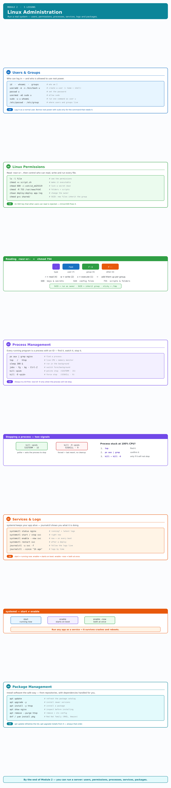
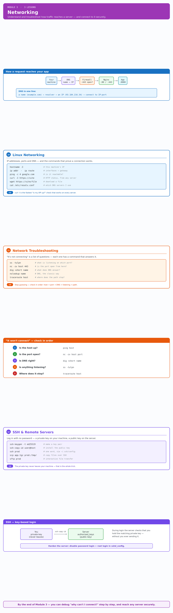
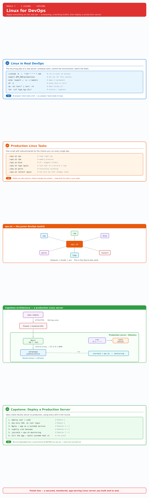

# 🗺️ Module maps

A one-page visual for every module — lesson cards plus the key concepts drawn out. Great for a quick refresher or for seeing how a module fits together before you dive into the lessons.

Each map comes in two files:
- **`.png`** — a static preview (shown below, and embedded in each module's README).
- **`.excalidraw`** — the editable source, with the **same drawing** as the PNG. Open it at [excalidraw.com](https://excalidraw.com) or with the **Excalidraw** VS Code extension to tweak or export your own version.

Both files are generated from one spec by [`generate.py`](generate.py) (`python3 generate.py`, needs `pillow` + `matplotlib`), so the source and the preview always match.

---

### Module 1 · Linux Basics

[Edit in Excalidraw →](module-1-linux-basics.excalidraw)

### Module 2 · Linux Administration

[Edit in Excalidraw →](module-2-linux-administration.excalidraw)

### Module 3 · Networking

[Edit in Excalidraw →](module-3-networking.excalidraw)

### Module 4 · Bash Scripting

[Edit in Excalidraw →](module-4-bash-scripting.excalidraw)

### Module 5 · Linux for DevOps _(capstone)_

[Edit in Excalidraw →](module-5-linux-for-devops.excalidraw)
